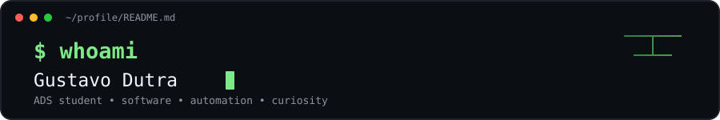
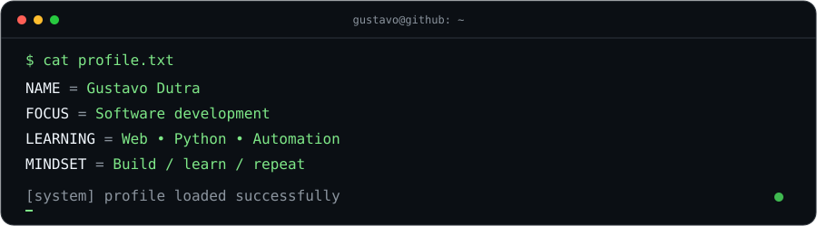

 

 

---

## Sobre mim

Sou estudante de **Análise e Desenvolvimento de Sistemas**, explorando desenvolvimento de software e construindo projetos para aprender na prática. Gosto de interfaces interativas, automação e de entender como as coisas funcionam por trás da tela.

- 🌱 Estudando lógica de programação, HTML, CSS e JavaScript
- 🧪 Experimentando ideias e transformando estudos em projetos
- 🎯 Buscando criar soluções úteis, acessíveis e bem construídas
- 🖥️ Aprendendo um passo de cada vez, com curiosidade e mão na massa

## Tecnologias em estudo

## Projetos

- **[AI Visual Orb](https://github.com/dutragusta/ai-visual-orb)** — interface experimental de interação visual com uma esfera animada.
- **[Entrelinhas: Livro 3D](https://github.com/dutragusta/entrelinhas-livro-3d)** — protótipo de uma experiência digital com livro interativo.
- **[Projeto Transforme-se](https://github.com/dutragusta/Projeto_Transforme-se)** — projeto de estudo desenvolvido durante a formação.

## Atividade no GitHub

---

*Construindo, testando, quebrando e aprendendo. O ciclo clássico do desenvolvimento.*

