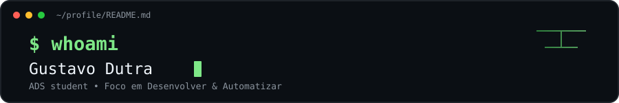

## Sobre mim

Estudante de **Análise e Desenvolvimento de Sistemas**, com interesse em desenvolvimento de software, automação de processos e tecnologia.

Busco transformar ideias em soluções funcionais, simplificar tarefas e aprimorar meus conhecimentos em programação.

## Tecnologias e ferramentas

## Estatísticas do GitHub

## Contato

[LinkedIn](https://www.linkedin.com/in/gustavodutrads/) · [GitHub](https://github.com/dutragusta)
