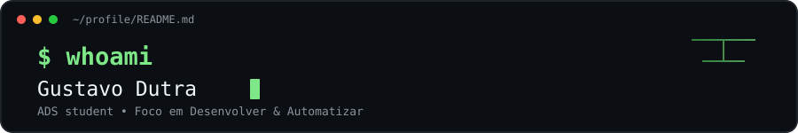
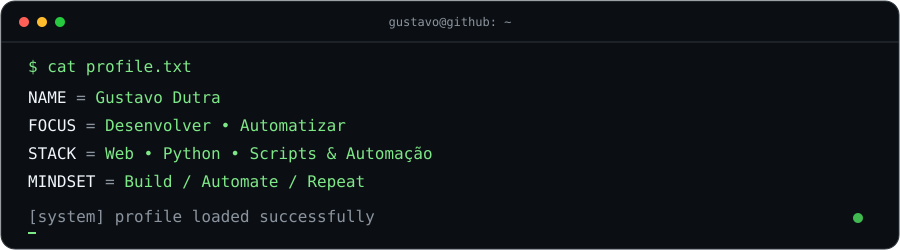

  

  

---

### 👨‍💻 Sobre mim

Sou estudante de **Análise e Desenvolvimento de Sistemas**, apaixonado por tecnologia, desenvolvimento de software e criação de interfaces interativas e modernas. Meu foco é aprender na prática, desenvolvendo projetos que unem design inovador, efeitos visuais e boa usabilidade.

- 🎓 Graduando em **Análise e Desenvolvimento de Sistemas**
- 💡 Foco atual em **JavaScript, Python, interfaces web interativas e automação**
- 🎨 Interesse especial em animações web, efeitos 3D e experiências imersivas
- 🚀 Sempre explorando novas ferramentas e aprimorando lógica de programação

---

### 🛠️ Tecnologias e Ferramentas

#### Front-end & Design

#### Programação & Backend

#### Ferramentas & Versionamento

---

### 🚀 Projetos em Destaque

<table>
  <tr>
    <td width="50%">
      <h3 align="center">📖 Entrelinhas: Livro 3D</h3>
      
Homepage com visual moderno e protótipo interativo de um livro em 3D integrado via web.

      

        
      

    </td>
    <td width="50%">
      <h3 align="center">✨ Projeto Transforme-se</h3>
      
Interface de login inovadora desenvolvida com fundo animado em caracteres ASCII e efeitos holográficos 3D.

      

        
      

    </td>
  </tr>
</table>

---

### 📊 Estatísticas do GitHub

  

 

<picture>
  <source media="(prefers-color-scheme: dark)" srcset="https://raw.githubusercontent.com/dutragusta/dutragusta/output/snake-dark.svg">
  <source media="(prefers-color-scheme: light)" srcset="https://raw.githubusercontent.com/dutragusta/dutragusta/output/snake.svg">
  
</picture>

---

*"Construindo, testando, quebrando e aprendendo. O ciclo clássico do desenvolvimento."* 🚀

